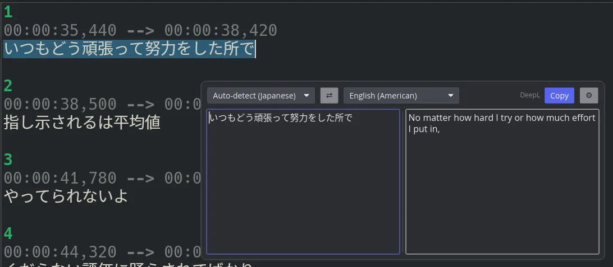
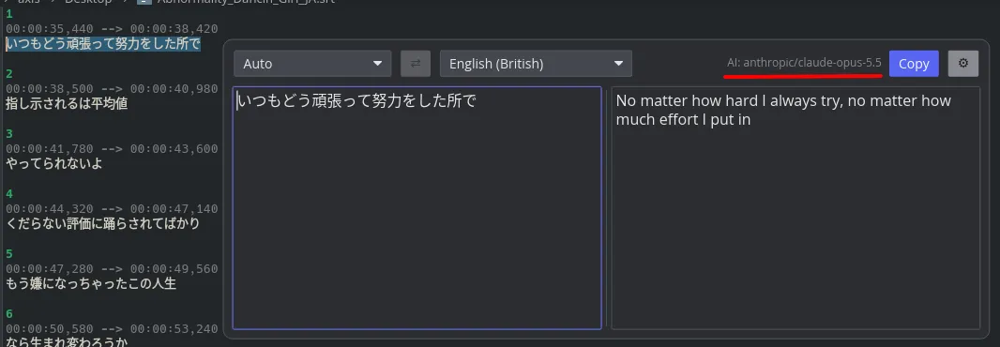

# Quick Translate

Select text in any app, press a shortcut, and read the translation in a popup at your mouse
cursor. A small resident daemon for **Wayland** desktops.

**Bring your own backend:** connect a **DeepL API key** (the free tier works) or any **AI
model** through an OpenAI-compatible endpoint (OpenAI, OpenRouter, Ollama, LM Studio and
others).

Inspired by the **DeepL desktop client** for Windows and macOS, which has no Linux version.
Quick Translate brings the same shortcut-and-popup workflow to Linux. It is an independent
project and is not affiliated with DeepL.

| DeepL | Any OpenAI-compatible model |
|---|---|
|  |  |

## Features

- Opens at the cursor, reads your **clipboard** (or the current selection if the clipboard is
  empty), and translates as you type.
- Source and translation side by side, with source language auto-detect, a swap button and a
  settings button.
- **Esc** closes, **Ctrl+C** copies the translation and closes.
- Backends: **DeepL** (default) or any **OpenAI-compatible** endpoint: OpenAI, OpenRouter,
  Ollama, LM Studio and others.
- Private: text goes only to the backend you chose, is never written to disk or logs, and API
  keys live in the desktop keyring. No telemetry.

## Install

**AppImage** (any distribution, glibc 2.35 or newer): download it from the
[releases page](https://github.com/ErenEksen/quick-translate/releases), then

```sh
chmod +x quick-translate-*-x86_64.AppImage
./quick-translate-*-x86_64.AppImage
```

**Nix**: `nix run github:ErenEksen/quick-translate`

**From source** (Rust 1.90+, `pkg-config`, Wayland and xkbcommon development files):

```sh
cargo build --release -p quick-translate
./target/release/quick-translate
```

## Setup

1. Run `quick-translate` once. The daemon starts, adds a launcher entry and starts on login.
2. Run it again, or click the gear in the popup, to open **settings** and add your backend
   (a DeepL API key, or a base URL, model and key for an OpenAI-compatible server). See
   [docs/backends.md](docs/backends.md).
3. Press **Ctrl+Alt+C**. Compositors without a global-shortcut portal (Sway, niri, ...) need
   a key bound to `quick-translate --toggle`; settings shows a snippet. See
   [docs/shortcuts.md](docs/shortcuts.md).

## Supported desktops

Wayland only; X11 is not supported.

- **Full:** KDE Plasma 6, Hyprland, Sway, niri, labwc, Wayfire, river, COSMIC.
- **Reduced:** GNOME 48+, where the popup is a centered window because GNOME has no
  layer-shell.

`quick-translate --status` shows what your session provides.

## More

- [Full guide](docs/guide.md): commands, lifecycle, removal, troubleshooting, building
  AppImage and Nix packages.
- [Testing](docs/testing.md)

## License

MIT or Apache-2.0, at your option.
